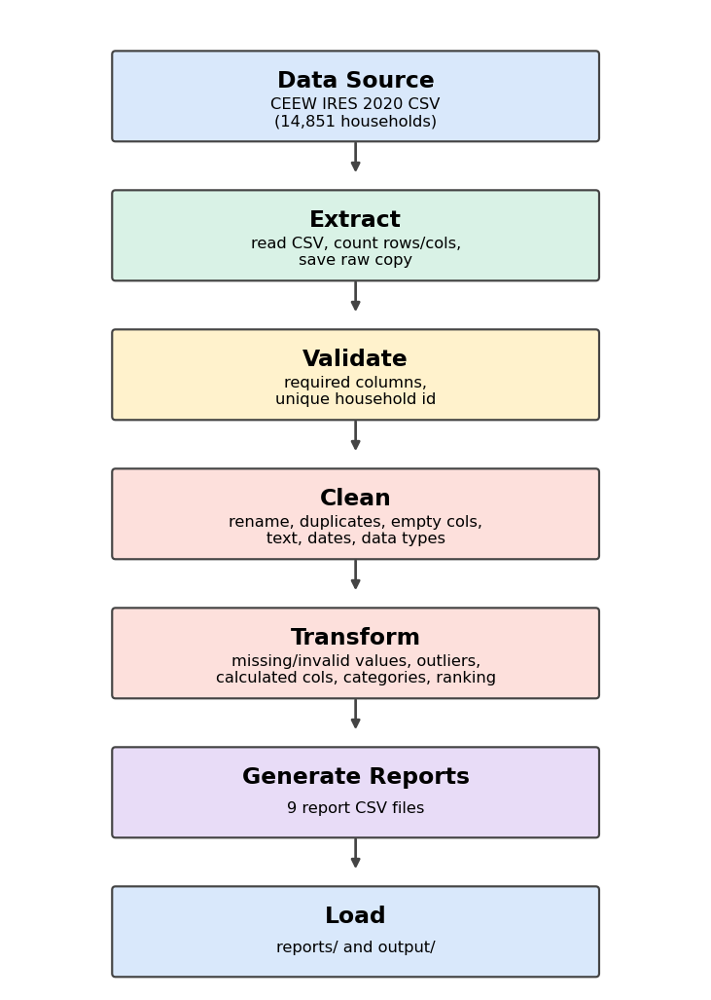

# CEEW Household Energy ETL Pipeline

## Objective
Turn the raw India Residential Energy Survey (IRES) 2020 file into a clean, analysis-ready dataset
and a set of summary reports that future Data Science projects can use directly.

## Data Source
India Residential Energy Survey (IRES) 2020 by the Council on Energy, Environment and Water (CEEW),
published on Harvard Dataverse (doi:10.7910/DVN/AHFINM). A structured CSV with 14,851 households and
517 columns. Full description: [docs/dataset_description.md](docs/dataset_description.md).

## ETL Workflow


`run_etl_pipeline()` in `pipeline.py` runs: **extract() -> transform() -> generate_reports() -> load()**.
The pipeline only runs when the file is executed directly (`python pipeline.py`).

## Project Structure
```
CEEW_Energy_ETL/
├── raw_data/        original CSV + the copy saved by extract()
├── reports/         all report CSV files
├── screenshots/     evidence screenshots
├── output/          analysis-ready dataset + pipeline log
├── etl/             one module per team member
├── docs/            dataset description, flow diagram, transformation notes
├── tests/
├── pipeline.py
├── README.md
└── requirements.txt
```

## How to run
```
pip install -r requirements.txt
python pipeline.py
```

## List of Transformations
Details and reasons are in [docs/transformations.md](docs/transformations.md).
1. Rename columns  2. Remove duplicates  3. Remove empty columns  4. Standardise text
5. Convert dates  6. Change data types  7. Replace "don't know" codes  8. Validation / remove invalid values
9. Cap outliers  10. Handle missing values  11. Calculated columns  12. Categories  13. Ranking  14. Sort

## Reports Generated (in `reports/`)
| File | Content |
|------|---------|
| cleaned_data.csv | complete cleaned dataset |
| summary_statistics.csv | count, mean, min, max etc. of key columns |
| state_wise_report.csv | households, spending, bills and house ownership per state, ranked |
| top10_districts_by_elec_bill.csv | 10 districts with the highest average bill |
| bottom10_districts_by_elec_bill.csv | 10 districts with the lowest average bill |
| income_category_report.csv | spending and bills by income category |
| household_size_report.csv | small / medium / large households |
| monthly_interview_report.csv | interviews and average bill per month |
| remaining_missing_values_report.csv | columns that still have gaps (mostly "not applicable" questions) |

`output/` also holds `analysis_ready_data.csv.gz` and `pipeline_log.txt`.

## Challenges Faced
- 517 columns, 190 of them almost empty.
- Dates written in two formats (`12/18/2019` and `12-10-2019`).
- Survey codes 88 and 99 mean "don't know" and looked like real numbers.
- Extreme values, for example a land area above 100 million sq ft.
- Many blanks are not errors: a household without an AC is never asked AC questions, so those blanks were kept.
- Working as five people on one repository (branches, pull requests, merge order).

## Learning Outcomes
*(edit in your own words)*
- Building a modular ETL pipeline with extract, transform and load functions.
- Cleaning real survey data with pandas.
- Telling apart missing data that should be filled from data that is missing by design.
- Using Git branches, pull requests and code review in a team.

## Future Improvements
- Apply the survey weights so results represent all of India.
- Use the official codebook to label every coded column.
- Load the result into a database instead of CSV files.
- Add charts to the reports and schedule the pipeline to run automatically.

## Team
| Member | Part | File |
|--------|------|------|
| 1 | Extract, validation, project setup | etl/extract_step.py |
| 2 | Structural cleaning | etl/member2_structural_cleaning.py |
| 3 | Missing and invalid values, outliers | etl/member3_missing_invalid.py |
| 4 | Features, categories, ranking | etl/member4_features.py |
| 5 | Reports and load | etl/member5_reports_load.py |
